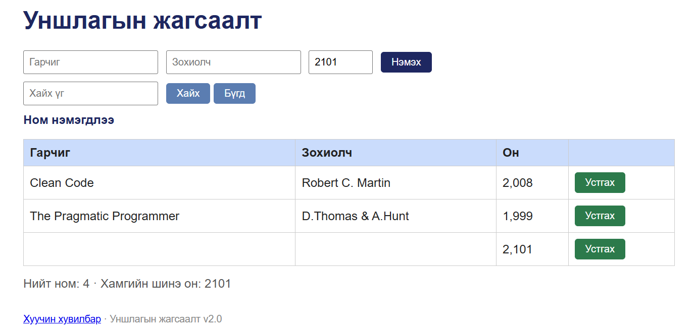

# BUG-01: Гарчиг, Зохиолч хоосон байхад ном нэмэгдэж «Ном нэмэгдлээ» гэж харагдана

Орчин: Уншлагын жагсаалт v2.0, Google Chrome 155.0.8059.79, Windows 10 22H2 (19045.7725), 2026-10-14
Урьдчилсан нөхцөл: `node app.js`-ийг шинээр асаасан (анхны 3 ном)

## Дахин гаргах алхам
1. Chrome-оор http://localhost:3000 нээнэ.
2. «Гарчиг», «Зохиолч» талбарыг хоосон үлдээнэ.
3. «Он» талбарт `1999` гэж бичнэ.
4. «Нэмэх» товчийг дарна.

Хүлээгдэж байсан: «Ном нэмэхэд Гарчиг, Зохиолч, Он гурван талбар бүгд заавал бөглөгдсөн байх ёстой; дутуу бол ном нэмэгдэхгүй, ойлгомжтой алдааны мессеж харагдана.»

Бодит үр дүн: Гарчиг, Зохиолч нь хоосон мөр хүснэгтэд нэмэгдэж, «Ном нэмэгдлээ» мессеж гарна. API-аар `{"title":"","author":"","year":1999}` илгээхэд мөн `HTTP/1.1 201 Created` (evidence/api-empty-fields.txt).

Ноцтой байдал: Major — заавал талбарын шалгалт огт ажиллахгүй тул хоосон, утгагүй бичлэг жагсаалтад ордог.

Хавсралт:  · evidence/api-empty-fields.txt

Олдсон аялал: Couch Potato
