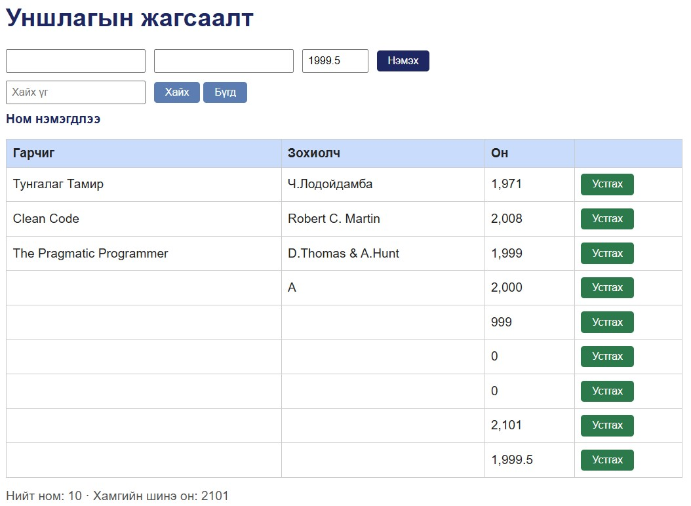

# BUG-01: Ном нэмэх форм дээр Гарчиг, Зохиолч, Он хоосон байхад ном нэмэгддэг

Орчин: Уншлагын жагсаалт v2.0, Chrome 155.0.8059.85, Windows 10 Pro, 2026-10-23

Урьдчилсан нөхцөл: node app.js-ийг шинээр асаасан (анхны 3 ном), http://localhost:3000 нээлттэй

## Дахин гаргах алхам
1. Гарчиг, Зохиолч, Он гурван талбарыг хоосон үлдээнэ.
2. «Нэмэх» товч дарна.

Хүлээгдэж байсан: Спецификацийн «Ном нэмэхэд Гарчиг, Зохиолч, Он гурван талбар бүгд заавал бөглөгдсөн байх ёстой; дутуу бол ном нэмэгдэхгүй, ойлгомжтой алдааны мессеж харагдана» дүрмийн дагуу ном нэмэгдэхгүй, алдааны мессеж гарна.

Бодит үр дүн: Хүснэгтэд Гарчиг, Зохиолч хоосон шинэ мөр нэмэгдэж, Он нь «0» болж харагдана. «Ном нэмэгдлээ» гэсэн амжилтын мессеж гарна. Зөвхөн Гарчигийг хоосон үлдээхэд (Зохиолч «A», Он 2000) мөн адил нэмэгдэнэ — нэг шалтгааны хувилбар.

Ноцтой байдал: Major — заавал шаардлагатай талбарын шалгалт огт ажиллахгүй тул жагсаалт утгагүй хоосон бичлэгээр дүүрнэ; ажлыг тойрох арга бий (хэрэглэгч гараар устгах) тул Critical биш.

Хавсралт: screenshots/bug-01.jpg

Скриншотод хэд хэдэн хоосон мөр (Он 999, 0, 0, 2,101, 1,999.5) харагдана; Оны хязгаар (BUG-02), таслал (BUG-03), тоолуурын зөрүү (BUG-04) мөн энэ дэлгэцэд харагдана.

Олдсон аялал: Couch Potato
