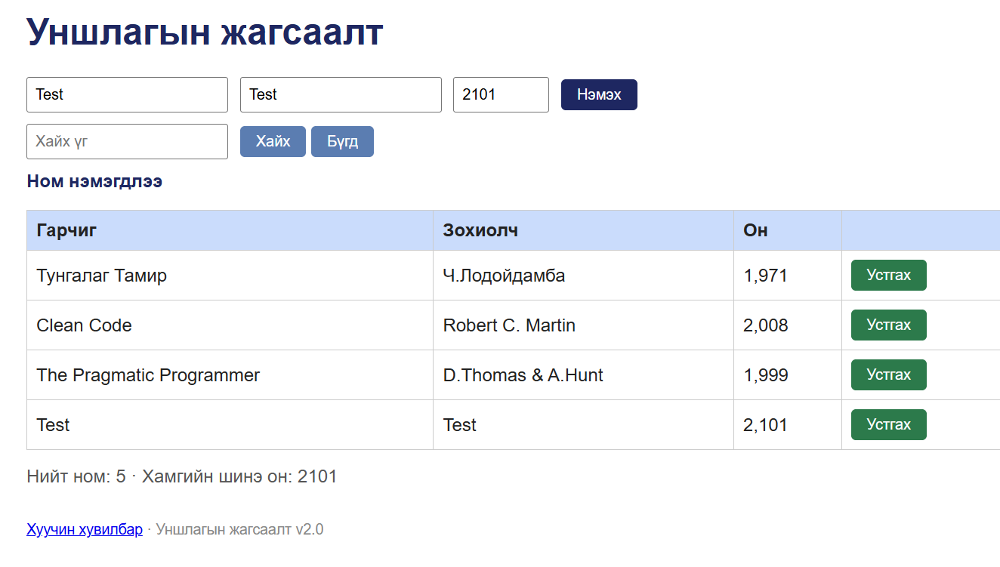

# BUG-02: 1000-2100 хязгаараас гадуур он (2101, 999) хүлээн авч ном нэмэгдэнэ

Орчин: Уншлагын жагсаалт v2.0, Google Chrome 155.0.8059.79, Windows 10 22H2 (19045.7725), 2026-10-14
Урьдчилсан нөхцөл: `node app.js`-ийг шинээр асаасан (анхны 3 ном)

## Дахин гаргах алхам
1. Chrome-оор http://localhost:3000 нээнэ.
2. «Гарчиг» талбарт `Test`, «Зохиолч» талбарт `Test`, «Он» талбарт `2101` гэж бичнэ.
3. «Нэмэх» товчийг дарна.
4. (Хувилбар) «Он» талбарт `999` гэж бичээд дахин оролдоно.

Хүлээгдэж байсан: «Он нь 1000-2100 хоорондох бүхэл тоо» — ном нэмэгдэхгүй, алдааны мессеж харагдана.

Бодит үр дүн: 2101 онтой ном хүснэгтэд нэмэгдэж, «Нийт ном» доор «Хамгийн шинэ он: 2101» гэж харагдана. API-аар 2101, 999, 1999.5, "abc" он бүгд `HTTP/1.1 201 Created` буцаана.

Ноцтой байдал: Major — хүчингүй өгөгдөл системд орж, «Хамгийн шинэ он» зэрэг тооцоог гажуудуулна.

Хавсралт:  · evidence/api-year-2101.txt · evidence/api-year-999.txt · evidence/api-year-decimal.txt · evidence/api-year-text.txt

Олдсон аялал: Saboteur (UI-д хил хязгаарын утга)
