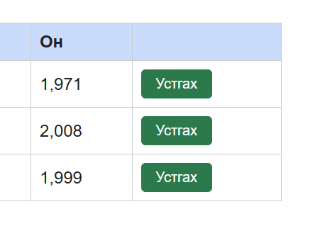

# BUG-03: Хүснэгтэд он мянгатын таслалтай (2,008 / 1,999) харагдана

Орчин: Уншлагын жагсаалт v2.0, Google Chrome 155.0.8059.79, Windows 10 22H2 (19045.7725), 2026-10-14
Урьдчилсан нөхцөл: `node app.js`-ийг шинээр асаасан (анхны 3 ном)

## Дахин гаргах алхам
1. Chrome-оор http://localhost:3000 нээнэ.
2. Хүснэгтийн «Он» баганыг харна.

Хүлээгдэж байсан: «Он ... хүснэгтэд энгийн тоогоор (жишээ нь 1999) харагдана.»

Бодит үр дүн: «Clean Code» → `2,008`, «The Pragmatic Programmer» → `1,999` гэж таслалтай харагдана.

Ноцтой байдал: Cosmetic — өгөгдөл зөв боловч харагдах формат спецификацид нийцэхгүй, он гэдэг нь ойлгомж муутай.

Хавсралт: 

Олдсон аялал: Supermodel
