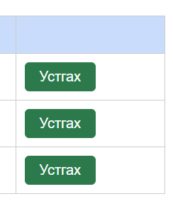

# BUG-04: «Устгах» товч улаан биш ногоон өнгөтэй

Орчин: Уншлагын жагсаалт v2.0, Google Chrome 155.0.8059.79, Windows 10 22H2 (19045.7725), 2026-10-14
Урьдчилсан нөхцөл: `node app.js`-ийг шинээр асаасан (анхны 3 ном)

## Дахин гаргах алхам
1. Chrome-оор http://localhost:3000 нээнэ.
2. Хүснэгтийн мөр бүрийн «Устгах» товчийн өнгийг харна.

Хүлээгдэж байсан: «Аюултай үйлдлийн товч (Устгах) улаан өнгөтэй.»

Бодит үр дүн: «Устгах» товч ногоон өнгөтэй — ногоон нь ихэвчлэн «аюулгүй/батлах» гэсэн утгатай тул хэрэглэгч андуурч дарах эрсдэлтэй.

Ноцтой байдал: Minor — функц ажиллана, гэхдээ аюултай үйлдлийн анхааруулга алга.

Хавсралт: 

Олдсон аялал: Supermodel
