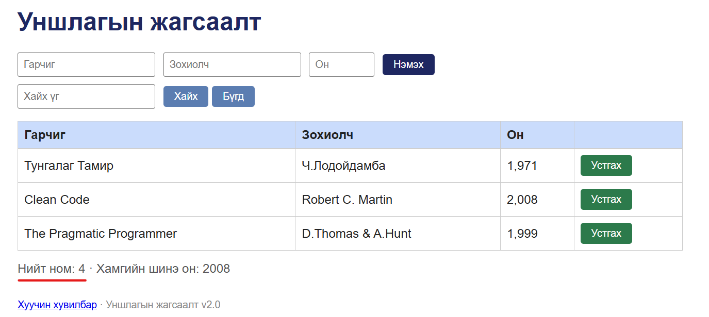

# BUG-05: «Нийт ном» тоолуур хүснэгтийн мөрийн тооноос 1-ээр их харагдана

Орчин: Уншлагын жагсаалт v2.0, Google Chrome 155.0.8059.79, Windows 10 22H2 (19045.7725), 2026-10-14
Урьдчилсан нөхцөл: `node app.js`-ийг шинээр асаасан (анхны 3 ном)

## Дахин гаргах алхам
1. Chrome-оор http://localhost:3000 нээнэ.
2. Хүснэгтийн мөрийг тоолно (Тунгалаг Тамир, Clean Code, The Pragmatic Programmer — 3 мөр).
3. Хүснэгтийн доорх «Нийт ном» утгыг харна.
4. (Хувилбар) Гарчиг `Test`, Зохиолч `Test`, Он `1999` оруулж «Нэмэх» дарна — мөр 4 болно, тоолуурыг дахин харна.

Хүлээгдэж байсан: «“Нийт ном” тоолуур хүснэгтэд буй номын тоотой тэнцүү.»

Бодит үр дүн: 3 мөртэй байхад «Нийт ном: 4»; ном нэмсний дараа 4 мөртэй байхад «Нийт ном: 5».

Ноцтой байдал: Minor — өгөгдөл зөв боловч хэрэглэгчид буруу тоо харагдаж, итгэлийг бууруулна.

Хавсралт: 

Олдсон аялал: FedEx
