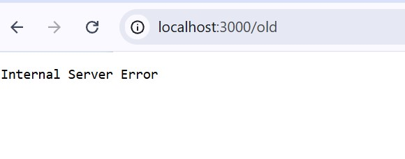

# BUG-06 — «Хуучин хувилбар» (/old) линк 500 Internal Server Error өгнө

| Талбар | Утга |
|---|---|
| Олдсон | 2026-10-23, 23:18 |
| Аялал | Supermodel |
| Түвшин | UI / HTTP |
| Ноцтой байдал | Major |
| Давтагдах | Байнга |
| Орчин | Windows 10 Pro · Chrome 155.0.8059.85 · Node v24.13.0 · «Уншлагын жагсаалт» v2.0 (localhost:3000) |

## Алхам
1. Аппыг асааж, http://localhost:3000 нээнэ.
2. Хуудасны доод талын «Хуучин хувилбар» линк дарна.

## Хүлээгдэж буй үр дүн
Хуучин хувилбарын хуудас нээгдэнэ (эсвэл линк байхгүй/идэвхгүй байна).

## Бодит үр дүн
http://localhost:3000/old хаяг руу шилжиж «Internal Server Error» гэсэн текст гарна. HTTP статус 500.

## Нотолгоо


`curl.exe -i http://localhost:3000/old` → [evidence/bug-06-curl.txt](../evidence/bug-06-curl.txt)

```
HTTP/1.1 500 Internal Server Error
Content-Type: text/plain; charset=utf-8
Date: Fri, 23 Oct 2026 15:18:17 GMT
Connection: keep-alive
Keep-Alive: timeout=5
Transfer-Encoding: chunked

Internal Server Error
```
