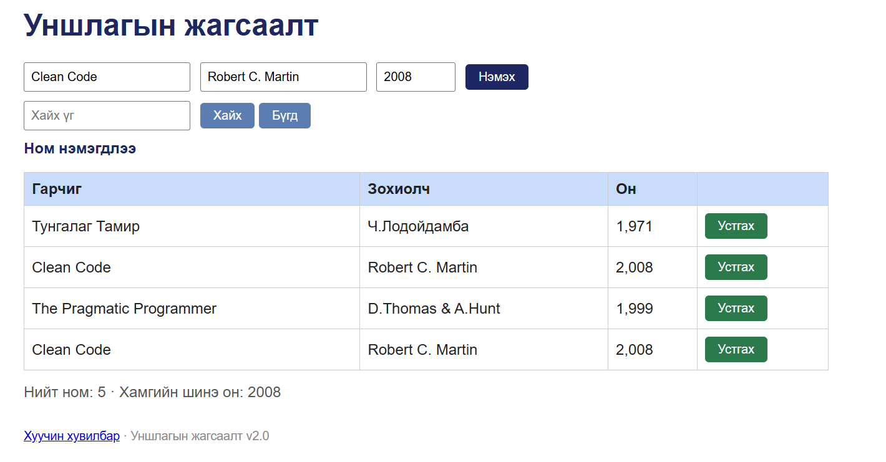

# BUG-06: Ижил гарчиг, зохиолчтой ном давхардаж нэмэгдэнэ

Орчин: Уншлагын жагсаалт v2.0, Google Chrome 155.0.8059.79, Windows 10 22H2 (19045.7725), 2026-10-14
Урьдчилсан нөхцөл: `node app.js`-ийг шинээр асаасан (анхны 3 ном)

## Дахин гаргах алхам
1. Chrome-оор http://localhost:3000 нээнэ.
2. «Гарчиг» талбарт `Clean Code`, «Зохиолч» талбарт `Robert C. Martin`, «Он» талбарт `2008` гэж бичнэ.
3. «Нэмэх» товчийг дарна.

Хүлээгдэж байсан: «Ижил гарчиг, зохиолчтой ном давхардуулж нэмэгдэхгүй.»

Бодит үр дүн: «Clean Code / Robert C. Martin» хүснэгтэд хоёр удаа харагдаж, «Нийт ном» нэгээр нэмэгдэнэ. API-аар мөн `HTTP/1.1 201 Created` (evidence/api-duplicate.txt).

Ноцтой байдал: Major — өгөгдлийн бүрэн бүтэн байдал алдагдаж, тоолуур бодит номын тоог буруу харуулна.

Хавсралт:  · evidence/api-duplicate.txt

Олдсон аялал: FedEx
