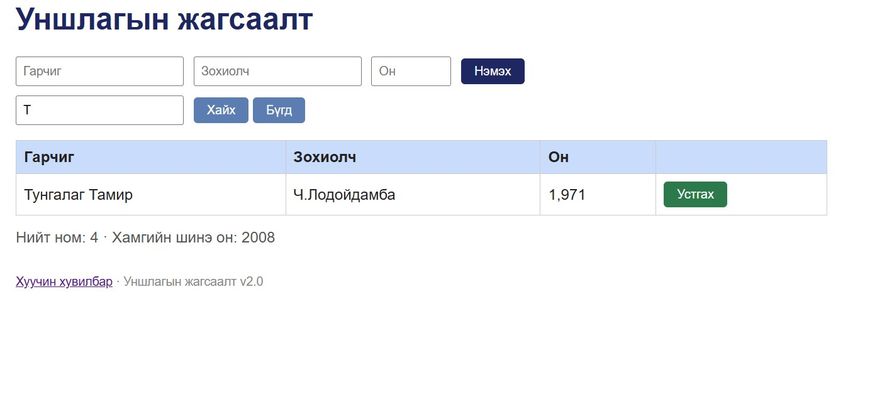

# BUG-07 — Хайлт том/жижиг үсэг ялгадаг

| Талбар | Утга |
|---|---|
| Олдсон | 2026-10-23, 23:20–23:26 |
| Аялал | Fed-Ex |
| Түвшин | UI (хайлт) |
| Ноцтой байдал | Minor |
| Давтагдах | Байнга |
| Орчин | Windows 10 Pro · Chrome 155.0.8059.85 · Node v24.13.0 · «Уншлагын жагсаалт» v2.0 (localhost:3000) |

## Алхам
1. Аппыг асаана. Хүснэгтэд «Тунгалаг Тамир» ном байгаа эсэхийг шалгана.
2. Хайх талбарт `тунгалаг` (жижиг үсгээр) бичээд «Хайх» дарна.
3. Хайх талбарт `Т` (том үсгээр) бичээд «Хайх» дарна.

## Хүлээгдэж буй үр дүн
Хоёр хайлт хоёулаа «Тунгалаг Тамир»-ыг олно (хайлт үсгийн хэмжээ ялгахгүй).

## Бодит үр дүн
- `тунгалаг` → 0 мөр.
- `Т` → «Тунгалаг Тамир» олдсон, 1 мөр.

## Нотолгоо

Скриншот нь 3-р алхмыг (`Т` → 1 мөр) харуулна. 2-р алхмын (0 мөр) үр дүнг notes.txt-ийн 23:20 мөрөнд тэмдэглэсэн.
