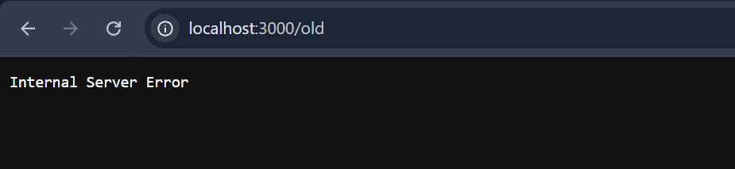

# BUG-08: «Хуучин хувилбар» линк /old хуудсыг нээхэд «Internal Server Error» гарна

Орчин: Уншлагын жагсаалт v2.0, Google Chrome 155.0.8059.79, Windows 10 22H2 (19045.7725), 2026-10-14
Урьдчилсан нөхцөл: `node app.js`-ийг шинээр асаасан (анхны 3 ном)

## Дахин гаргах алхам
1. Chrome-оор http://localhost:3000 нээнэ.
2. Хуудасны доод талын «Хуучин хувилбар» линк дээр дарна.

Хүлээгдэж байсан: «бүх хуудас, линк ажиллана.»

Бодит үр дүн: localhost:3000/old хуудас нээгдэж зөвхөн «Internal Server Error» гэсэн текст харагдана; curl -i → HTTP/1.1 500 Internal Server Error.

Ноцтой байдал: Major — хэрэглэгчид харагдах линк серверийн алдаа үүсгэнэ.

Хавсралт:  · evidence/bug-08-curl.txt

Олдсон аялал: Supermodel (харагдах бүх линкийг дарах)
